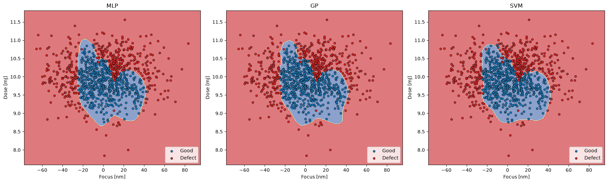

# Lithography Defect Prediction

This project predicts whether a die will be defective in a semiconductor lithography process using only two critical process parameters: **focus [nm]** and **exposure dose [mJ]**. Three machine learning classifiers are trained, compared, and visualized over the focus-dose process window.

## Approach

1. **Data Preprocessing**: Exposure data and inspection data are cleaned by dropping rows with missing values, then inner-joined on `Lot`, `Wafer`, `FieldX`, and `FieldY`.
2. **Feature Engineering**: `Focus` and `Dose` are extracted as features to predict a binary `label` (0 = good, 1 = defect).
3. **Data Splitting**: The dataset is split using an 80/20 stratified train/test split. A `StandardScaler` is fitted exclusively on the training set to prevent test-set leakage.
4. **Modeling**: Three distinct classifiers are trained:
* Multilayer Perceptron (3 hidden layers × 40 neurons)
* Gaussian Process Classifier (RBF kernel)
* Support Vector Machine (RBF kernel, gamma=2, C=1)


5. **Evaluation**: Models are evaluated using confusion matrices, precision, recall, and F1 scores. Decision boundaries are plotted in their original focus and dose units.

## Results

After executing the pipeline, the outputs are saved to the `results/` directory:

* **`metrics.csv`**: Contains accuracy, defect-class precision, recall, and F1 scores per model.
* **`decision_boundaries.png`**: Visualizes the decision boundary of each model over the data.
* **`raw_data.png`**: Displays a raw scatter plot of good vs. defective samples in the focus-dose plane.

### Test-Set Performance (20% Stratified Hold-Out)

*Note: Defect class = positive.*

| Model | Accuracy | Defect Precision | Defect Recall | Defect F1 |
| --- | --- | --- | --- | --- |
| **MLP** | 0.95 | 0.943 | 0.943 | 0.943 |
| **GP** | 0.955 | 0.944 | 0.955 | 0.949 |
| **SVM** | 0.95 | 0.933 | 0.955 | 0.944 |

The Gaussian Process (GP) classifier demonstrated the highest overall performance, yielding an accuracy of 0.955 and an F1 score of 0.949. However, the performance margins between the three models are minimal, indicating that all three effectively map the process window without significant divergence on a test set of this size.
 
 


## Usage

First, install the required dependencies:

```bash
pip install -r requirements.txt
```

Run the main pipeline (the script will automatically read from the included `./data` directory):

```bash
python main.py \
    --exposure data/exposure_data.csv \
    --inspection data/inspection_data.csv \
    --out results
```

## Project Structure

```text
litho-defect-predictor-main/
├── data/                       
│   ├── exposure_data.csv       
│   └── inspection_data.csv     
├── results/                    
│   ├── decision_boundaries.png 
│   ├── metrics.csv             
│   └── raw_data.png            
├── main.py                     
├── README.md                   
└── requirements.txt            
```

## Notes

* **Data Included**: The raw datasets (`exposure_data.csv`, `inspection_data.csv`) are provided in the `data/` directory so the project can be run immediately out of the box.
* **Dynamic Column Detection**: Feature and label columns are detected by name (`focus`, `dose`, `label`), with positional fallbacks if the names differ in standard datasets.
* **Future Extensions**: Potential next steps include hyperparameter tuning via `GridSearchCV`, implementing k-fold cross-validation, and expanding the feature set to include additional scanner or track parameters.
